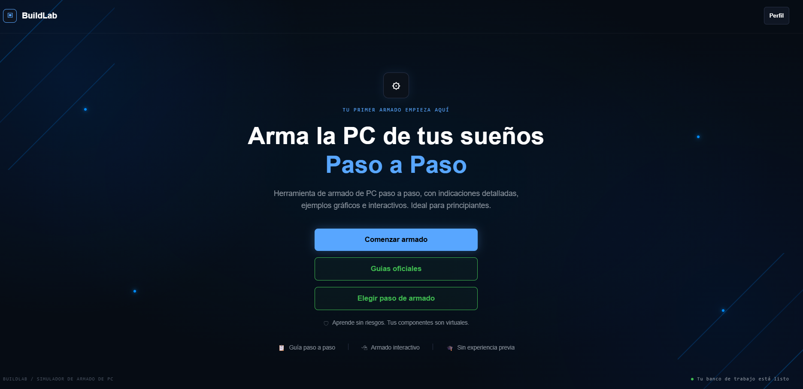
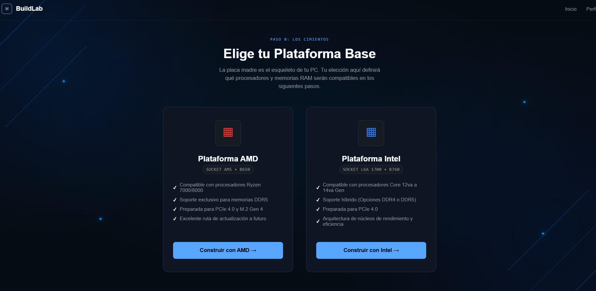
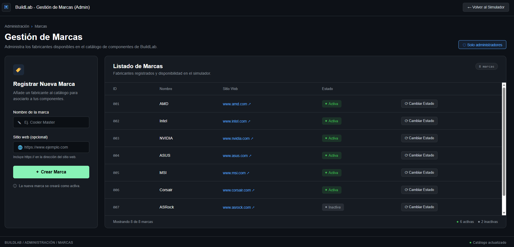

# PC Builder App

Aplicación web interactiva para guiar a usuarios principiantes durante el armado de una computadora, explicar la función de cada componente y validar compatibilidades entre piezas.

> Trabajo práctico final de Programación Orientada a Objetos 3, Grupo 7.

## Descripción

PC Builder App propone un recorrido visual y paso a paso para seleccionar los componentes de una PC. La aplicación permite definir el perfil de uso, elegir una plataforma y avanzar por el armado con información contextual y controles de compatibilidad.

El proyecto combina una interfaz web desarrollada con HTML, CSS y JavaScript, una API creada con Python y FastAPI, y una base de datos PostgreSQL para administrar el catálogo de componentes.

## Funcionalidades principales

- Selección del perfil de uso de la computadora.
- Elección de plataforma y placa madre.
- Armado guiado paso a paso.
- Catálogo dinámico de componentes.
- Validación de compatibilidad entre piezas.
- Resumen de la configuración seleccionada.
- Panel administrativo para gestionar marcas y componentes.
- Persistencia de datos en PostgreSQL.

## Tecnologías utilizadas

### Frontend

- HTML5
- CSS3
- JavaScript

### Backend

- Python
- FastAPI
- Uvicorn

### Base de datos

- PostgreSQL
- SQL y PL/pgSQL

### Herramientas

- Git y GitHub
- Visual Studio Code

## Capturas de pantalla

### Página de inicio

La pantalla principal presenta el objetivo de la aplicación y permite comenzar el recorrido de armado.



### Selección de perfil

El usuario puede indicar el uso principal de la computadora para adaptar las recomendaciones del sistema.



### Selección de plataforma

La aplicación permite elegir la plataforma base antes de continuar con los componentes compatibles.


### Panel administrativo

El panel administrativo permite consultar y gestionar las marcas y los componentes disponibles en el catálogo.



## Estructura del proyecto

```text
PC-Builder-App/
├── backend/              # API y lógica del servidor
├── database/             # Scripts y recursos de PostgreSQL
├── docs/
│   └── screenshots/      # Capturas utilizadas por este README
├── frontend/             # HTML, CSS, JavaScript y recursos visuales
├── requirements.txt      # Dependencias de Python
└── README.md
```

## Instalación y ejecución local

### 1. Clonar el repositorio

```bash
git clone https://github.com/FedericoGuillen/PC-Builder-App.git
cd PC-Builder-App
```

### 2. Crear y activar un entorno virtual

En Windows PowerShell:

```powershell
python -m venv .venv
.\.venv\Scripts\Activate.ps1
```

En macOS o Linux:

```bash
python3 -m venv .venv
source .venv/bin/activate
```

### 3. Instalar las dependencias

```bash
pip install -r requirements.txt
```

### 4. Configurar PostgreSQL

Crear la base de datos y ejecutar los scripts incluidos en la carpeta `database/`. Verificar también que la configuración de conexión utilizada por el backend coincida con el entorno local.

> No publiques contraseñas ni credenciales en GitHub. Utilizá variables de entorno y mantené el archivo `.env` dentro de `.gitignore`.

### 5. Iniciar el servidor

```bash
uvicorn backend.main:app --reload
```

Luego, abrir la dirección local informada por Uvicorn. De forma predeterminada suele ser `http://127.0.0.1:8000`.

## Mi contribución

Participé en las siguientes áreas del proyecto:

- Diseño de la base de datos PostgreSQL.
- Creación de consultas SQL.
- Desarrollo de funciones y procedimientos.
- Gestión del repositorio en GitHub.
- Testing e integración.

## Integrantes, Grupo 7

- Almada Gonzalo
- Gonzalez Sofia
- Guillen Federico
- Morilla Lucas
- Ortega Yasmin

## Próximas mejoras

- Ampliar las reglas de compatibilidad entre componentes.
- Incorporar filtros por presupuesto, marca y rendimiento.
- Agregar pruebas automatizadas del backend.
- Mejorar la experiencia responsive en dispositivos móviles.
- Publicar una demo online con frontend, API y base de datos desplegados.

## Repositorio

[Ver PC Builder App en GitHub](https://github.com/FedericoGuillen/PC-Builder-App)
